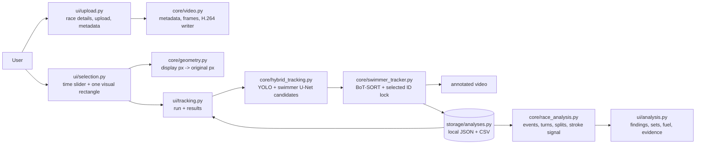

# SwimVision

**Turn ordinary swim race footage into measurable performance data.**

> Built for the 2026 Congressional App Challenge.
> **Status: persistent tracking works on the full Video(2) regression; the first evidence-labelled race-analysis report is now implemented for 25/50/100/200 events.** See the [Roadmap](#roadmap).

## Problem

Competitive swimmers often have videos of their races, but a normal video only shows *what* happened. To understand *why* time was gained or lost, a swimmer or coach has to replay footage by hand and manually measure strokes, breakouts, turns and splits. Professional sports-analysis systems that automate this are expensive or inaccessible.

## Solution

SwimVision lets a swimmer upload an ordinary race video and uses computer vision to measure the race. Every number shown comes from the video, from user input, or from a calculation the app performs. **Nothing is hard-coded or simulated.**

## Features

| Feature | Status |
|---|---|
| Race setup: every individual pool event - free, back, breast, fly, IM - in SCY / SCM / LCM, with lengths, turns and IM legs | ✅ Phase 1 (metadata only) |
| Video upload (MP4 / MOV / AVI / M4V / MKV), real FPS / frames / duration / resolution | ✅ Phase 1 |
| Choose the swimmer visually with one rectangle—no frame numbers or coordinates | ✅ Phase 2 |
| Hybrid YOLO + swimmer U-Net detection with persistent identity and gap prediction | ✅ Phase 2 (validating) |
| Annotated tracking video + per-frame CSV | ✅ Phase 2 |
| Automatic takeoff estimate, expected-turn detection and per-length splits for 25/50/100/200 | ✅ First analysis version |
| Temporal swimmer-crop stroke-cycle estimate with explicit confidence/limitations | ✅ First analysis version |
| Plain-language findings, evidence, example training sets and general nutrition/recovery guidance | ✅ First analysis version |
| Audio-buzzer timing, wall-contact finish, calibrated pool coordinates and swim-specific pose | Next validation phases |

## How Phase 2 works

1. **Choose.** Move a time slider until the swimmer is visible, drag the yellow box around them, and click **Use this swimmer**. The app reads the time, frame and pixel coordinates itself. This is the only manual selection.
2. **Track.** Click **Track my swimmer**. YOLO finds the selected person before water entry. As soon as that track receives a swimmer U-Net heatmap observation, the app permanently switches it to heatmap-only tracking so pool-deck people cannot interfere. BoT-SORT compensates for camera motion and gives each trajectory a persistent ID; the box you draw selects one ID.
3. **Bridge gaps.** Low-confidence heatmap regions are retained so BoT-SORT can use its second association stage to recover the selected trajectory through splash and partial submersion. If the selected ID is unavailable, the app predicts briefly and then reports searching; it never substitutes a different swimmer ID.
4. **Report.** The result shows followed/lost frames, every lost interval, an annotated video and a per-frame CSV. Green boxes are detector observations; yellow boxes are short predictions through a gap.

Timing always comes from frame index ÷ the video's real FPS. Videos above 30 fps are analysed every *n*-th frame (60 fps -> every 2nd); timestamps stay exact.

## Architecture



**Design rules**

- `core/` has no Streamlit code, so it can be tested and run from scripts.
- All timing comes from frame index and real FPS.
- Expected failures raise `SwimVisionError` subclasses with a readable message, including the underlying detector/PyTorch error when tracking fails.
- Developer mode: start with `SWIMVISION_DEBUG=1` to see full tracebacks in the page; they are also written to `outputs/logs/swimvision.log`. Without it, the error type and message are shown and the traceback goes to the terminal.

## Technology stack

Python 3.12, Streamlit, streamlit-cropper, OpenCV, Ultralytics YOLO, PyTorch, NumPy, Pandas, FFmpeg (bundled via `imageio-ffmpeg`), pytest.

**Python version:** use **3.12**. Python 3.14 is not recommended because PyTorch/Ultralytics wheels lag behind.

## Installation

Windows PowerShell:

```powershell
cd SwimVision
py -3.12 -m venv .venv
.\.venv\Scripts\Activate.ps1
pip install -r requirements-dev.txt
```

macOS / Linux:

```bash
python3.12 -m venv .venv
source .venv/bin/activate
pip install -r requirements-dev.txt
```

No separate FFmpeg install is needed.

### GPU acceleration (strongly recommended with an NVIDIA GPU)

`pip install` gives the CPU build of PyTorch, which works but is slower. With an NVIDIA GPU, install the CUDA build *before* the requirements:

```powershell
pip install torch torchvision --index-url https://download.pytorch.org/whl/cu128
pip install -r requirements-dev.txt
```

The device used is shown under *Run details* after tracking.

### First run needs internet (once)

The small YOLO person-detector weights are downloaded by Ultralytics the first time tracking runs. The swimmer U-Net weights are included in `models/`. **Your video is never uploaded.**

## Running locally

```powershell
.\.venv\Scripts\python.exe -m streamlit run app.py
```

Open <http://localhost:8501>. Developer mode (PowerShell): `$env:SWIMVISION_DEBUG="1"` before the command.

In the app: upload the video, move the time slider, draw one box around the swimmer, click **Use this swimmer**, then click **Track my swimmer**. There are no frame numbers, pixel coordinates or lane boundaries to enter.

Tests: `.\.venv\Scripts\python.exe -m pytest`

## Race analysis

After tracking, click **Analyze my race**. The report supports every valid individual 25, 50, 100 and
200 yard/metre event in SCY, SCM and LCM, plus 100/200 short-course IM and 200 long-course IM. It uses
the tracker's deck-to-water state change to anchor takeoff, requires the correct number of direction
reversals before showing per-length splits, and analyses a temporal sequence of swimmer-only crops for
stroke rhythm. It never fills missing turns by dividing the race evenly.

The report has five plain-language tabs: summary, splits and strokes, training ideas, fuel and recovery,
and the exact frame-level evidence. Training and food suggestions are clearly identified as general
examples rather than prescriptions.

The analysis structure follows published work from
[SwimTrack](https://ceur-ws.org/Vol-3583/paper38.pdf),
[DeepDASH](https://ashwhall.github.io/download/Hall2020_Article_TheDetectionTrackingAndTempora.pdf),
and [stroke-rate estimation from race video](https://arxiv.org/abs/2104.12056). Nutrition language uses
food-first resources from [USA Swimming](https://www.usaswimming.org/parents/popular-resources/nutrition-and-recovery),
[USOPC](https://www.usopc.org/nutrition) and
[USADA](https://www.usada.org/athletes/substances/nutrition-guide/).
The complete source-to-feature map and validation gates are in
[docs/ANALYSIS_METHOD.md](docs/ANALYSIS_METHOD.md).

## Current limitations

- Hybrid tracking is still being validated across different pool angles, lighting and camera motion.
- Long camera cutaways can outlast identity memory. The tracker reports those frames as lost instead of silently choosing a different person.
- Watch the annotated video once to confirm that the box stayed on the intended swimmer.
- Takeoff is inferred from the deck-to-water transition. Audio-buzzer reaction time is not implemented.
- Finish currently uses the last tracked frame and is marked low confidence until wall-contact detection exists.
- Stroke cycles use a deterministic crop-motion signal, not a trained swim-pose model, and are marked for review.
- Per-length splits are withheld if all expected turns are not visible. Distance calibration and moving-camera
  registration remain future validation work.
- Non-MP4/H.264 uploads (MOV, AVI, HEVC) are shown through a re-encoded preview; the original file is always analysed.
- Variable-frame-rate videos use the container's average FPS. Upload limit is 1 GB (`.streamlit/config.toml`).

## Privacy

- **All video processing happens locally on your computer.**
- Videos are stored in `uploads/`, which is git-ignored. Unsaved uploads older than one hour are deleted automatically at start-up.
- The only network use is the one-time download of the model file.
- A later optional AI Coach will receive only calculated numbers, never video or frames.
- Never commit swim videos (especially of children). `.gitignore` blocks common video extensions and the `uploads/`, `outputs/`, `data/` and `models/` contents.

## AI use disclosure

Generative AI was used to help write this project. See [AI_USAGE.md](AI_USAGE.md) for specifics.

## Roadmap

1. **Phase 1 ✅** Setup, upload, metadata, playback
2. **Phase 2 (validating)** One visual selection, hybrid persistent tracking, annotated video, honest loss reporting
3. Phase 3 ✅ first version: temporal crop motion and stroke-cycle signal
4. Phase 4 ✅ first version: stroke count/rate with visible confidence warnings
5. Phase 5 🚧: takeoff and turns implemented; audio start, breakout and wall-contact finish next
6. Phase 6 ✅ first version: five-tab user-friendly analysis and evidence dashboard
7. Phase 7 🚧: expected-turn logic implemented; camera registration and pool calibration next
8. Phase 8: Race comparison
9. Phase 9: AI Coach
10. Phase 10: Validation, performance tuning, documentation
