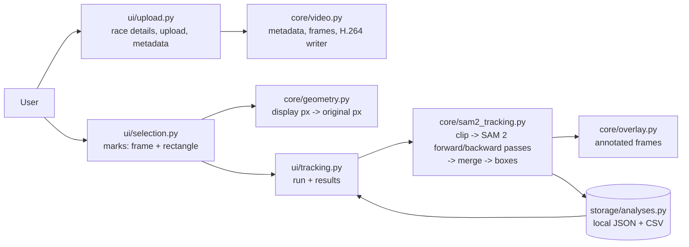

# SwimVision

**Turn ordinary swim race footage into measurable performance data.**

> Built for the 2026 Congressional App Challenge.
> **Status: Phase 1 done; Phase 2 (track one swimmer) simplified and being validated on real footage.** No stroke or race metrics exist yet. See the [Roadmap](#roadmap).

## Problem

Competitive swimmers often have videos of their races, but a normal video only shows *what* happened. To understand *why* time was gained or lost, a swimmer or coach has to replay footage by hand and manually measure strokes, breakouts, turns and splits. Professional sports-analysis systems that automate this are expensive or inaccessible.

## Solution

SwimVision lets a swimmer upload an ordinary race video and uses computer vision to measure the race. Every number shown comes from the video, from user input, or from a calculation the app performs. **Nothing is hard-coded or simulated.**

## Features

| Feature | Status |
|---|---|
| Race setup: every individual pool event - free, back, breast, fly, IM - in SCY / SCM / LCM, with lengths, turns and IM legs | ✅ Phase 1 (metadata only) |
| Video upload (MP4 / MOV / AVI / M4V / MKV), real FPS / frames / duration / resolution | ✅ Phase 1 |
| Mark the swimmer with a rectangle on one or more frames (e.g. on the block and after surfacing) | ✅ Phase 2 |
| Track that swimmer with SAM 2 forward and backward between marks; report every lost frame | ✅ Phase 2 (validating) |
| Annotated tracking video + per-frame CSV | ✅ Phase 2 |
| Pose, strokes, events, dashboard, calibration, comparison, AI coach, validation | Phases 3-10 |

## How Phase 2 works

1. **Mark.** Scrub to a frame, drag the yellow rectangle onto your swimmer (resize with its corners), check the zoomed view and the line `Selected box: x1 = … y1 = … x2 = … y2 = …` (original video pixels), then click **Mark swimmer on this frame**. For a race with a dive, mark the swimmer **on the block** and **again just after they surface**. You can add more marks wherever tracking gets lost (e.g. after a turn).
2. **Track.** Choose the analysis resolution (640 px / 960 px / original width) and when to stop (start with ~15 s). SwimVision copies the frames from the first mark to the stop time into a temporary clip and runs **Segment Anything 2.1** (Meta, via Ultralytics `SAM2VideoPredictor`):
   - a **forward pass** from each mark up to the next mark, and
   - a **backward pass** (on the reversed clip) from each later mark back to the previous mark.
   
   Each pass starts with your box as the prompt; SAM 2 keeps a memory of the frames it has seen and returns a mask of the swimmer on each new frame. On each frame: if only one pass found a mask, it is used; if both found the same thing (boxes overlap, IoU ≥ 0.3), the pass whose mark is closer wins; if they found **different** things, the frame is counted as **lost** (conflict) rather than guessing.
3. **Report.** Each mask becomes a box, converted back to original video pixels. A frame with no usable mask is **LOST** - it gets no coordinates and nothing is interpolated. The result shows analysed / tracked / lost frames, every lost interval with times, the longest loss, conflicts, an annotated video (mask, box, time, TRACKED/LOST) and a CSV with which pass produced each box.

**Why two marks for a dive:** SAM 2 remembers what the swimmer looked like standing on the block. After entry the swimmer is hidden in the splash for ~0.5 s and then looks completely different (underwater, stretched out, often with the camera zooming). On real footage SAM 2 never re-found the swimmer on its own - with the base or the large model. A mark after surfacing gives it the new appearance, and the backward pass from that mark fills the frames between entry and surfacing.

There is exactly one tracker. No detector, no automatic fallback, no automatic re-selection. Earlier experiments (YOLO + ByteTrack, OpenCV ViT tracker, camera-motion checks, checkpoints, background jobs) were removed from the app and kept for reference in `legacy/` (not imported, not maintained).

Timing always comes from frame index ÷ the video's real FPS. Videos above 30 fps are analysed every *n*-th frame (60 fps -> every 2nd); timestamps stay exact.

## Architecture



**Design rules**

- `core/` has no Streamlit code, so it can be tested and run from scripts.
- All timing comes from frame index and real FPS.
- Expected failures raise `SwimVisionError` subclasses with a readable message, including the exact SAM 2 / PyTorch error when tracking fails.
- Developer mode: start with `SWIMVISION_DEBUG=1` to see full tracebacks in the page; they are also written to `outputs/logs/swimvision.log`. Without it, the error type and message are shown and the traceback goes to the terminal.

## Technology stack

Python 3.12, Streamlit, streamlit-cropper, OpenCV, Ultralytics (SAM 2.1), PyTorch, NumPy, Pandas, FFmpeg (bundled via `imageio-ffmpeg`), pytest.

**Python version:** use **3.12**. Python 3.14 is not recommended because PyTorch/Ultralytics wheels lag behind.

## Installation

Windows PowerShell:

```powershell
cd SwimVision
py -3.12 -m venv .venv
.\.venv\Scripts\Activate.ps1
pip install -r requirements-dev.txt
```

macOS / Linux:

```bash
python3.12 -m venv .venv
source .venv/bin/activate
pip install -r requirements-dev.txt
```

No separate FFmpeg install is needed.

### GPU acceleration (strongly recommended with an NVIDIA GPU)

`pip install` gives the CPU build of PyTorch, which works but is very slow for SAM 2. With an NVIDIA GPU, install the CUDA build *before* the requirements:

```powershell
pip install torch torchvision --index-url https://download.pytorch.org/whl/cu128
pip install -r requirements-dev.txt
```

The device used is shown under *Run details* after tracking.

### First run needs internet (once)

The SAM 2.1 base weights (`sam2.1_b.pt`, ~155 MB) are downloaded into `models/` from the Ultralytics GitHub releases the first time tracking runs. **Only the model file is downloaded - your video is never uploaded.**

## Running locally

```powershell
.\.venv\Scripts\python.exe -m streamlit run app.py
```

Open <http://localhost:8501>. Developer mode (PowerShell): `$env:SWIMVISION_DEBUG="1"` before the command.

Tracking runs in the page itself with a progress bar. **Don't click anything while it runs** - Streamlit restarts the page on any click, which cancels the run.

Tests: `.\.venv\Scripts\python.exe -m pytest`

### Standalone tracking check (no Streamlit)

```powershell
.\.venv\Scripts\python.exe scripts\test_sam_tracking.py uploads\race.mp4 --mark 650 667 240 779 439 --mark 760 628 195 725 240 --seconds 15 --width 640
```

Each `--mark FRAME X1 Y1 X2 Y2` is a box in original video pixels on that frame (repeat for more marks; tracking starts at the first one); `--seconds 0` tracks to the end; `--width 0` analyses at original size. It prints versions, device, weights, mask checks, tracked %, every lost interval and the longest one, writes `outputs/test_sam_tracking.mp4` (+ `.csv`), saves `outputs/debug/test_sam_tracking/frame_000.jpg, frame_050.jpg, …` with the mask drawn, and reopens the MP4 to verify frames/FPS/size/codec. Errors are not caught: a failure prints the full traceback.

## Measured on real footage (developer's own 50 SCY side-view video, 848×464, 30 fps)

RTX 4070 Ti SUPER, fp16: ~15-17 analysed frames/s.

| Marks (frames) | Range | Mask found | Longest loss | What the debug frames show |
|---|---|---|---|---|
| In the water (900) | 5 s, 640 px | 96% | 0.10 s | Mask on the selected swimmer throughout |
| In the water (900) | to the end, original | 62% | 4.3 s | Lost when the camera came close (36.8-41.3 s) while the swimmer was visible; afterwards a mask appeared on a splash in a neighbouring lane - **possibly a different swimmer**; lost again for the last 4.3 s |
| Block only (650) | 15 s, 640 px | 14% | 13 s | Followed the dive through the air, lost at water entry although the swimmer was visible underwater; never recovered (SAM 2.1 large: same result) |
| Block (650) + just after surfacing (760) | 15 s, 640 px | 58% | 3.9 s | Tracked off the block, through the dive and underwater; entry gap only frames 712-727 (0.5 s, swimmer hidden by the splash); 0 conflicts. Most remaining loss is frames 801-918 where the camera points away from the swimmers. Swimmer found again from frame 919; around frames 950-1000 the mask is a small blob near the far lane - **identity not confirmed** |

"Mask found" only means SAM 2 returned a mask. It does not prove the mask is on the right swimmer; that has to be checked by watching the annotated video. These are a handful of runs on one video, not an accuracy evaluation.

## Current limitations

- **No swimming metrics yet.** Phase 2 only locates the swimmer.
- **With only a block mark, SAM 2 loses the swimmer at dive entry and does not find them again.** Add a second mark just after surfacing (see above). Finding the swimmer again automatically, without a second mark, did not work in our tests.
- SAM 2 also loses the swimmer when the camera zooms, pans away, or the swimmer is very small. Add a mark after each long loss.
- **After a loss SAM 2 can attach to a different swimmer or a splash** without any warning sign in the numbers. Watch the video.
- Positions are in **pixels**, not metres/yards (needs calibration, later phase).
- Non-MP4/H.264 uploads (MOV, AVI, HEVC) are shown through a re-encoded preview; the original file is always analysed.
- Variable-frame-rate videos use the container's average FPS. Upload limit is 1 GB (`.streamlit/config.toml`).

## Privacy

- **All video processing happens locally on your computer.**
- Videos are stored in `uploads/`, which is git-ignored. Unsaved uploads older than one hour are deleted automatically at start-up.
- The only network use is the one-time download of the model file.
- A later optional AI Coach will receive only calculated numbers, never video or frames.
- Never commit swim videos (especially of children). `.gitignore` blocks common video extensions and the `uploads/`, `outputs/`, `data/` and `models/` contents.

## AI use disclosure

Generative AI was used to help write this project. See [AI_USAGE.md](AI_USAGE.md) for specifics.

## Roadmap

1. **Phase 1 ✅** Setup, upload, metadata, playback
2. **Phase 2 (validating)** Select one swimmer, SAM 2 tracking, annotated video, honest loss reporting
3. Phase 3: Pose estimation
4. Phase 4: Stroke signal, stroke count, stroke rate
5. Phase 5: Start / breakout / finish (hybrid auto + manual)
6. Phase 6: Dashboard, clips, overlay video
7. Phase 7: Turns, distance calibration
8. Phase 8: Race comparison
9. Phase 9: AI Coach
10. Phase 10: Validation, performance tuning, documentation
